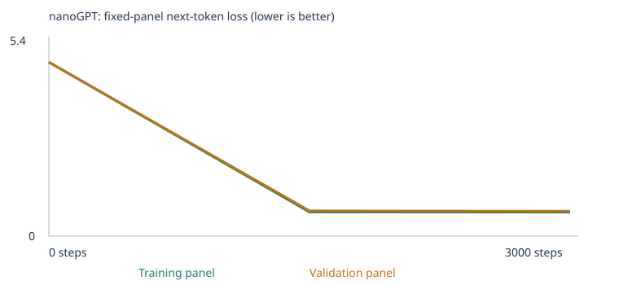
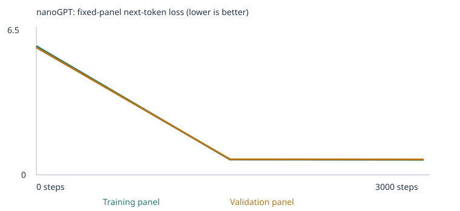
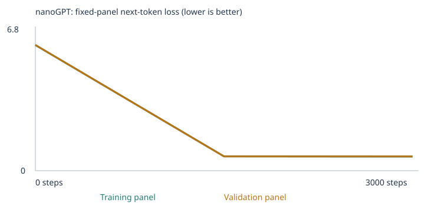

# Building a Custom LLM — My Experiments

I trained three small nanoGPT models from scratch. The starter model scored **20/48**, the first corpus extension scored **23/48**, and the second extension scored **21/48**. All three learned the 16 starter-pattern cases, but the added material did not produce broad language understanding. Only 26 of the 48 cases were scorable after either extension.

## Submission guide

These are my recorded runs, separate from the instructor's reference files in `examples/`.

| Experiment | Executed notebook | Complete results and models | Original run ID |
| --- | --- | --- | --- |
| Starter | [starter_custom_llm.ipynb](starter_custom_llm.ipynb) | [starter-results.zip](starter-results.zip) | 20260923T135231_435024Z |
| Extension 1 | [expanded_custom_llm.ipynb](expanded_custom_llm.ipynb) | [expanded-results.zip](expanded-results.zip) | 20260923T171437_833481Z |
| Extension 2 | [expanded2_custom_llm.ipynb](expanded2_custom_llm.ipynb) | [expanded2-results.zip](expanded2-results.zip) | 20260923T173357_871271Z |

- [EXPERIMENT_EVIDENCE.md](EXPERIMENT_EVIDENCE.md): all recorded loss rows, samples at steps 0/1500/3000, all category breakdowns before and after, complete 64-dimensional vectors, first updates, probabilities, neighbors, attention, temperature samples and actual chat transcripts.
- [EVAL_OUTPUTS.md](EVAL_OUTPUTS.md): every case from all six evaluation sets, including failures, unknown words and free continuations.
- [SOURCE_NOTES.md](SOURCE_NOTES.md) and [teaching-sources.zip](teaching-sources.zip): all six teaching files, exact hashes and AI-assistance disclosure.
- [VERIFICATION.json](VERIFICATION.json): saved-model execution checks. [Verification transcripts](verification-chat.zip) contain three new CLI interactions per trained model, separate from the original Colab chats.
- [Actual CLI chat recording](chat-recording.html): download and open this HTML file to replay three newly recorded interactions with the extension 1 model. [Raw recording](chat-recording.cast) and [matching transcript](recorded-chat.json) are also included.

**Download and extract the ZIPs to inspect or run the complete models.** Each result archive expands into `results/starter/`, `results/expanded/`, or `results/expanded2/`. Each contains `model.pt`, `model_untrained.pt`, `checkpoint.json`, `config.json`, `corpus.txt`, `corpus_manifest.json`, `split.json`, `tokenization.json`, `vocabulary_report.json`, `inspection.json`, `history.json`, `training.csv`, `training_curves.svg`, `training_summary.json`, `temperature_comparison.json`, `samples/`, `eval_separation.json`, `language_eval_comparison.json`, and `chat_transcript.json`. Both `language_evals/untrained/` and `language_evals/final/` contain the full suite, per-case JSON and CSV, and summary JSON.

## Why I used this data and these settings

I started with the classroom corpus because its short, repeated sentence patterns made it easier to see what the model learned. I used 3,000 steps and a learning rate of 0.001 because they were the recommended starting values for the assignment. My initial expectation was that common word combinations and sentence structures in the data would appear more often after training. I expected unfamiliar words and patterns to remain difficult.

For extension 1, I added 48 examples about opposites and 48 about negation. These were intended to introduce contrasting words and patterns such as “instead of” and “did not.” For extension 2, I kept those files and added four ordinary texts about music practice, studying, gardening, and a bakery, with 12 sentences each. I wanted to see whether more everyday text helped. This explanation of the extension choices is retrospective; I am not presenting it as a separately saved pre-training prediction.

All runs used `CORPUS="classroom"`, seed 42, batch size 32, context length 48, 64-dimensional embeddings, two transformer blocks and four attention heads. Training ran on CPU and completed all 3,000 steps. The learning rate used warmup and cosine decay; 0.001 was the configured peak, not a constant rate. The actual first update used 0.00001.

| Run | Added files / passages | Unique passages | Train / validation | Vocabulary | Parameters | Validation unknown-token rate |
| --- | --- | --- | --- | --- | --- | --- |
| Starter | 0 / 0 | 4,592 | 4,132 / 460 | 136 | 111,872 | 0% |
| Extension 1 | 2 / 96 | 4,688 | 4,219 / 469 | 333 | 124,480 | 0.0565% |
| Extension 2 | 6 / 144 | 4,736 | 4,262 / 474 | 459 | 132,544 | 0.6701% |

Training unknown-token rates were 0% in all runs. The vocabulary is built only from training passages. Words appearing only in validation may therefore remain unknown even when they exist somewhere in the source collection.

## What changed after training

In the starter run, training-panel loss fell from 4.9263 to 0.6783 and validation-panel loss fell from 4.9275 to 0.7061. The generated text became more like the teaching sentences. One final sample was: “the consumer compared the offering after checking the price .” This demonstrates learned local patterns, not a general ability to answer questions.

The extension runs also reduced their losses. Their final training/validation losses and every intermediate row are in the evidence report and plots below. These are **fixed panels of 20 training and 20 validation passages**, not full-corpus losses. The panels and vocabulary change when the corpus changes, so cross-run loss differences are not a clean ranking of general quality.





## Fixed language evaluation

The multiple-choice metric selects the highest-probability answer among four choices; ties count as incorrect. Unknown-word or overlong cases receive zero in the all-case score. Scorable accuracy excludes those cases, so it must be read alongside coverage. Sampled continuations are saved separately and do not determine the multiple-choice score.

| Run | Stage | All cases | All-case success | Scorable / all | Scorable accuracy |
| --- | --- | --- | --- | --- | --- |
| starter | untrained | 9/48 | 18.8% | 24/48 | 37.5% |
| starter | final | 20/48 | 41.7% | 24/48 | 83.3% |
| expanded | untrained | 6/48 | 12.5% | 26/48 | 23.1% |
| expanded | final | 23/48 | 47.9% | 26/48 | 88.5% |
| expanded2 | untrained | 5/48 | 10.4% | 26/48 | 19.2% |
| expanded2 | final | 21/48 | 43.8% | 26/48 | 80.8% |


At the group level, the final starter-pattern score was 16/16 in every run. Starter-transfer scores were 4/8, 6/8 and 4/8. Extension scores were 0/24, 1/24 and 1/24. In both expanded runs, only two extension cases were scorable, both in opposites; negation still had no scorable cases. The full before/after group and category tables are in [the evidence report](EXPERIMENT_EVIDENCE.md).

The first extension increased coverage from 24/48 to 26/48, but adding the four everyday texts did not increase it further. Knowing some new words is insufficient: a case needs usable prompt words and all answer-choice words. A category can therefore remain unscorable even after adding relevant teaching examples.

There are failures beyond vocabulary. In the starter model, the usable-vocabulary case `lang_18` chose “harvest” when “student” was expected. In extension 1, `lang_20` chose “order” instead of “fruit.” These show that familiar words do not guarantee correct behavior under a new phrasing. Also, the starter's `lang_03` received a correct multiple-choice score while its free continuation began with “return,” showing why the two outputs must be inspected separately.

Extension 1 had the best observed overall score, but this is one run per corpus. Adding data changes the passage split, token IDs, vocabulary size and parameter count. The same seed does not make these otherwise identical trials. I cannot conclude that four everyday texts caused the score to fall or that one corpus is reliably better without repeated controlled runs.

## How the model learned

Text is lowercased and split into word/punctuation tokens. Each token gets an arbitrary integer ID, with special tokens for unknown words, beginning and end. The starter ID for `customer` is 28; in the expanded vocabularies it is 74 and 104. These numbers are lookup indices, not semantic scores.

The lookup table gives each token 64 trainable numbers. Position embeddings add information about order. Attention combines earlier token representations; linear layers, GELU, LayerNorm and residual connections transform them into next-token logits. Softmax turns logits into probabilities. Next-token cross-entropy penalizes low probability for the actual next token; backpropagation computes gradients, and AdamW updates the parameters.

For starter `customer`, the first recorded embedding coordinate was **−0.0575919151**, its first gradient was **+0.0006925872**, and the first update changed it to **−0.0576019064**. After the full run it was **+0.0366296843**. The first positive gradient is consistent with a downward update, but AdamW uses adaptive moments and weight decay, so the update is not simply `learning_rate × gradient`. All 64 coordinates before/after and the actual first-update records are included for every run in the evidence report.

For the prefix “the customer,” the starter's initial top prediction was “customer” with probability 0.0160. After training, the top predictions were “reviewed” (0.1782), “recommended” (0.1712), “ordered” (0.1685), “selected” (0.1634), and “compared” (0.1597). The model learned verbs used after that prefix in the corpus.

The evidence report computes the nearest `customer` neighbors with cosine similarity over all 64 dimensions of the actual saved tables. Similar repeated contexts can place words near one another. A single coordinate has no fixed named meaning, and the viewer's 3D PCA projection can distort distances. Load my `checkpoint.json` into [embedding-viewer.html](embedding-viewer.html) to inspect my run; the viewer's bundled default is an instructor reference, not my result.

The starter attention matrix for the inspected prefix has zeros above the diagonal: later tokens are hidden. Its last row is approximately `[0.4851, 0.4230, 0.0919]`. This saved attention view shows weighting over available positions, not proof of human-like reasoning or a complete explanation of every model decision.

## Temperature and actual chat behavior

Temperature changes the sampling distribution during inference without updating weights. Lower temperature concentrates probability; higher temperature allows less likely tokens. In my starter samples, 0.8 and 1.2 happened to produce the same four sentences, so higher temperature did not visibly change that small sample. In extension 2, temperature 1.2 produced the awkward sentence “the open during feel assignment frame and did not in not expensive was the relative choice .” Lower-temperature samples were more consistent with the teaching templates.

There are **9, 5 and 4 actual Colab chat interactions**, respectively, with the model hash and training-step count saved in each transcript. Every prompt starts fresh. Starter prompts “the idol,” “Yujin,” and “class” were flagged as unknown; “class” produced an empty reply. The original saved transcript preserves these failures. The separate CLI recording linked above demonstrates three actual new interactions with the saved extension 1 model. An empty reply is an observed generation outcome, not evidence that the model understood and refused the question.

The third model could complete “the customer” with “returned the merchandise after checking the price .”, but completed “the teacher” with “chose a bus and did not removed the station .” It combined familiar fragments without maintaining good grammar. This is a next-token model, not a general chat assistant.

## Separation, limitations and next experiment

The saved normalized suite hash is `1d7c503f34d88260d0ac897bc36b8ba621cccc1950aef47e7121e69b2c1c9e1d` in every run. The same 48 tests were retained before and after training. Each separation report records 160 excluded starter passages before splitting and vocabulary construction. Imported text was checked for normalized exact test-prompt matches. This check does not detect all semantic overlap.

The first extension was created with AI assistance after consulting public benchmark/category information. This is a **public development benchmark**, not an unseen test. The source notes explain that provenance. The evaluation files, answer keys, result reports and transcripts are kept outside the teaching corpus. No test answers were used as labels in the training procedure. The model was trained to predict the next token in the teaching text.

The 90/10 split is by deduplicated passage, not source file. Training and validation can share templates and passages from the same source document. Low validation loss therefore supports learning these controlled patterns, not generalization to new domains. The model has only 48 tokens of context, a small vocabulary, and little varied teaching data. Unknown words map to UNK, and fluent-looking output can be unrelated or logically wrong.

My next experiment would use a separately written, balanced set of teaching sentences for opposites and negation, with varied contexts and enough repeated vocabulary. I would keep the existing tests fixed, avoid tailoring sentences to individual answers, and repeat training across several seeds. I would compare coverage and scorable accuracy separately and inspect new free continuations. I would not assume that more unrelated text or more training steps automatically helps.

## Run the saved models

Clone/download this repository. Use Python 3.10+ and install dependencies, then extract the result archives from the repository root:

```bash
python -m pip install -r requirements.txt
python -m zipfile -e starter-results.zip .
python -m zipfile -e expanded-results.zip .
python -m zipfile -e expanded2-results.zip .
python run_evals.py --model results/expanded/model.pt --suite results/expanded/language_evals/final/eval_cases.json --output verification/expanded-final
python chat.py --model results/expanded/model.pt --transcript verification/expanded-chat.json
```

Use a new, empty evaluation output folder and a new chat transcript filename for each verification. Enter `/quit` to exit chat. Replace `expanded` with `starter` or `expanded2` to test the other models. `model.pt` contains the full network for inference; `checkpoint.json` is for the embedding viewer. Neither is a complete optimizer/random-state checkpoint for exact training resume.

All six saved initial/final models and all three chat commands were checked again locally; see [VERIFICATION.json](VERIFICATION.json). Original training used Python 3.13.15 and PyTorch 2.11.0+cpu on Linux. Local verification used a different environment, recorded in that file. Sampling text can differ across platforms or versions.

## Reproduce training without mixing corpora

The executed notebooks retain their original outputs and settings. For a fresh local run, extract [teaching-sources.zip](teaching-sources.zip), then prepare the chosen run's isolated corpus:

```bash
python -m zipfile -e teaching-sources.zip .
python prepare_corpus.py starter
# Or: python prepare_corpus.py expanded
# Or: python prepare_corpus.py expanded2
```

In a fresh copy of the corresponding notebook, set `CORPUS_FOLDER` to the printed directory (for example `reproduction_corpus/expanded`), retain `CORPUS="classroom"`, and run from the top. Starter gets no added files; expanded gets only a/b; expanded2 gets all six. The helper refuses to overwrite an existing corpus folder. In Colab, opening a notebook from GitHub does not bring along these source files: upload only the selected files into that runtime's corpus folder after setup, then rerun from the top. Save new results separately.

The classroom/nanoGPT code is credited in [UPSTREAM_README.md](UPSTREAM_README.md) and [NANOGPT_LICENSE](NANOGPT_LICENSE). AI assistance was used for explanations, synthetic texts, report preparation and submission checks; see [SOURCE_NOTES.md](SOURCE_NOTES.md).
